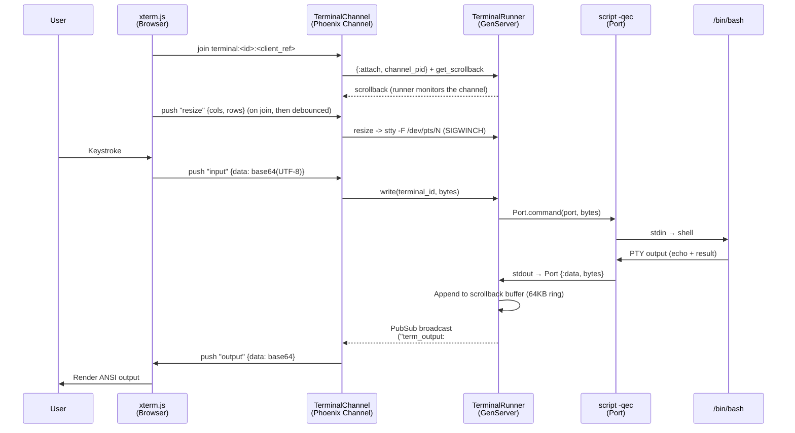
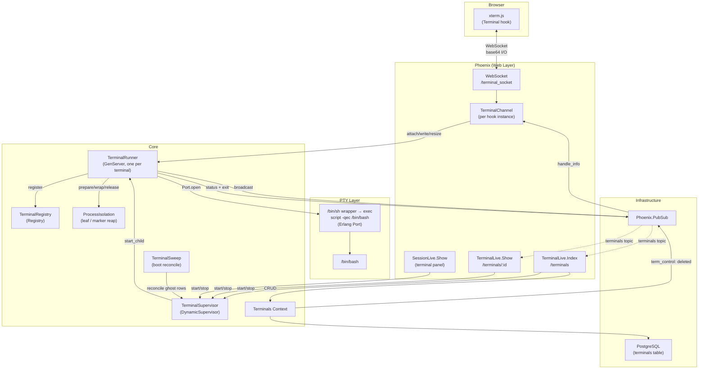

# Terminal System

Embedded web terminals powered by xterm.js, with PTY management via
`script -qec` running under an Erlang Port.

## Data Flow



## Architecture



## PubSub Topic Design

```
term_output:<terminal_id>   → per-terminal output + status + exit events
                               (subscribed by TerminalChannel)

terminals                   → {terminal_id, status | exit} for every terminal,
                               never output (TerminalLive.Index / Show)

term_control:<terminal_id>  → {:terminal_deleted, id} from
                               Terminals.delete_terminal/1 (the runner)
```

**Important:** The `term_output:` prefix is intentionally different from the
Channel topic `terminal:`. Phoenix Channels internally subscribe the channel
process to PubSub using the channel topic name. Using the same name would
cause double delivery (`:pg.join` allows duplicate joins).

Output never goes to `terminals`: an open index page reloaded the whole list
for every output chunk of every terminal until 2026-11-05.

## Terminal Lifecycle

```mermaid
stateDiagram-v2
    [*] --> stopped: Terminal created<br>(DB record)

    stopped --> running: start_terminal<br>(TerminalSupervisor)
    running --> stopped: Stop / Restart<br>or idle teardown<br>or node shutdown<br>(shell tree killed)
    running --> dead: shell exits<br>(exit, Ctrl+D; code kept)<br>or runner crash
    running --> dead: TerminalSweep at boot<br>(row "running", no runner)
    running --> stopped: Stop on a ghost row<br>(no runner; reconciled)
    dead --> running: start_terminal<br>(restart)
    stopped --> [*]: delete_terminal<br>(always stops first)
    dead --> [*]: delete_terminal<br>(always stops first)

    note right of running
        TerminalRunner GenServer active (traps exits).
        Port open to `script -qec <shell> /dev/null`
        through the ProcessIsolation wrapper.
        Output streamed via PubSub.
        Scrollback buffer maintained (64KB).
        Clients counted; idle clock running.
    end note
```



`runner_node` stays on the row after a stop, so Start/Restart go back to the
same node (its directory is there). A stop or delete targets the row's
`runner_node` only; an offline node is reported ("node offline" badge,
"not currently connected" flash), never re-routed.

### Teardown: every stop path kills the shell's tree

The runner traps exits, so a supervisor stop (`stop_terminal/1`, node
shutdown) runs `terminate/2`. Every path ends the same way:

1. `Port.close/1`.
2. SIGKILL `script`'s process group (`OrcaHub.OSProcess.signal_group/2`;
   erl_child_setup setsid()s every port child, and the wrapper `exec`s
   script, so the port's os_pid is script's and leads its group). The pty
   master closes, so the kernel hangs up the shell's session with SIGHUP.
3. `ProcessIsolation.release(spawn, grace_ms: 500)`: after the grace, the
   reaper SIGKILLs the cgroup leaf and every process carrying the spawn's
   `ORCA_AGENT_SPAWN_ID` (`terminal-<id>-<hex>`), which catches a `nohup`ed
   job and anything else that ignored the SIGHUP.

| Path | How the runner ends | Row afterwards |
|------|---------------------|----------------|
| Stop / Restart / node shutdown | supervisor `:shutdown` → `terminate/2` | `stopped` |
| Idle teardown | `{:stop, {:shutdown, :idle}}` (+ note line) | `stopped` |
| Shell exits (`exit`, Ctrl+D) | `{:exit_status, code}`: one `terminal_exit` broadcast, leftovers reaped | `dead` |
| Row deleted | `term_control` broadcast, or the 60 s row check | gone |
| Callback crash | `terminate/2` | `dead` |
| Brutal kill (`:kill`) | no `terminate/2`; ProcessIsolation's monitor reaps after 3 s | `running` until reconciled |

Before 2026-11-05 teardown was a bare `Port.close/1`, and through the
supervisor not even that ran `terminate/2` (no trap_exit), so the row also
kept reading `running`. A shell at an idle prompt exits on stdin EOF, but
one running a foreground job, and every `nohup`ed job, outlived the
terminal.

### Ghost rows and liveness

A row can read `running` with no runner: the node restarted (systemd / the
pod killed the cgroup), or the runner was killed outright. Three things
handle it:

- **Stop** on a ghost (`TerminalSupervisor.stop_terminal/1` finds no live
  runner on this node) reconciles the row to `stopped` and broadcasts it,
  returning `{:ok, :reconciled}`. It refuses a row another node owns.
- **`OrcaHub.TerminalSweep`** (hub + agent, once ~5 s after boot, gated by
  `ORCA_AUTO_RESUME` like the resumers) marks this node's own `running` rows
  with no live runner `dead`. Own-node rows only. It never restarts a shell.
- **The UI shows a status derived from liveness**
  (`Cluster.terminal_liveness/1`, one RPC per connected node;
  `Cluster.terminal_display_status/2`): a live runner shows `running`, a
  `running` row without one shows `dead` with Start, and an unreachable node
  keeps the row's word plus a "node offline" badge (no `Node.connect/1`
  attempt, so one offline node cannot stall a page).

Both reconcile writes are conditional (`Terminals.reconcile_terminal_status/3`
only updates a row still reading `running`). `terminal_alive?/1` checks
`Process.alive?/1` on the registered pid: Registry drops a dead pid's entry
asynchronously (same race df230c6 fixed for sessions).

### Delete

`TerminalLive.Index` always calls `stop_terminal` on the row's
`runner_node` first, whatever the row's status says, and deletes only once
that succeeded. If the stop cannot run (node offline), the delete is refused
with the reason. `Terminals.delete_terminal/1` is idempotent (`allow_stale`)
and broadcasts `{:terminal_deleted, id}` on `term_control:<id>`; a runner
that still exists for a vanished row stops itself (that broadcast, or its
60 s row check).

### Idle teardown

A running terminal is stopped after `ORCA_TERMINAL_IDLE_TIMEOUT_MINUTES`
(default 30; `0` disables; `config :orca_hub, :terminal_idle_timeout_minutes`)
with **no client attached AND no PTY output**. It is a normal stop (tree
killed, row `stopped`), with a note line on the output topic:
`[Terminal stopped: no viewer and no output for N minute(s). ...]`.

- **Clients**: `TerminalChannel` sends `{:attach, channel_pid}` on join, and
  again when a runner it stays joined to restarts (`{:terminal_status,
  :running}`). The runner monitors that pid on whatever node it is; `:DOWN`
  detaches it. Attach is a plain message followed by the `get_scrollback`
  call, so a runner from before attach existed ignores it.
- **Clock**: output, input, attach and detach reset `last_activity`. The
  timer runs only while no client is attached; when it fires it re-arms for
  the remainder, and only the most recently armed timer (tagged by ref)
  counts. A terminal started with nobody watching gets the full timeout.

## PTY Implementation

The PTY is managed via `script -qec <shell> /dev/null` spawned as an
Erlang Port through `OrcaHub.ProcessIsolation`, the same wrapper the agent
CLIs use: `prepare("terminal-<id>")`, `wrap/4`, and the port opens a tiny
`/bin/sh` that raises `oom_score_adj`, joins the spawn's cgroup leaf where
the unit delegates one (with the agent memory/pids limits), and `exec`s
script. The env carries `ORCA_AGENT_SPAWN_ID` (the marker) in every mode.
`script` allocates a PTY so the shell behaves as an interactive terminal
(colored output, line editing, etc.). The typescript file is `/dev/null` so
only PTY output flows through the port. `-e` makes script exit with the
shell's own status, so "[Process exited with code N]" is the shell's code.

The shell comes from `terminal.shell` (default `/bin/bash`), and the arg
order is OS-dependent: `["-qec", shell, "/dev/null"]` on Linux versus
`["-q", "/dev/null", shell]` on macOS. `TERM`/`COLUMNS`/`LINES` are seeded
into the port env, which is itself subject to the owning node's env
scrubbing policy (`OrcaHub.NodePolicy`) exactly like a session's.

### Size

script's stdin is a pipe, so its pty starts at **0x0** (`stty size` in the
shell said `0 0` before 2026-11-05, whatever xterm showed: wrapped prompts,
misaligned redraws). The runner sets the pty slave's size with
`stty -F /dev/pts/N rows R cols C`, the TIOCSWINSZ that makes the kernel
SIGWINCH the shell's foreground process group:

- the pts comes from script's own fds (it holds the slave open), falling
  back to its child's fd 0; without `/proc` (macOS) it is a no-op;
- the first push waits for the shell's first output, so `stty` (a fresh
  session leader) can never open the pts before the shell has made it its
  controlling tty; it applies the row's stored size;
- resizes are validated (1..1000), debounced (100 ms) and applied only on a
  change; the row keeps the last size for the next start.

The hook reports its size on every (re)join and after a restart, debounced
(150 ms) and only on change.

## Browser hook (`assets/js/terminal_hook.js`)

- **xterm is not in `app.js`.** It and its stylesheet are the lazily loaded
  `terminal-js`/`terminal-css` bundle (`assets/js/lazy/terminal.js`, the
  `orca_hub_lazy` esbuild profile; see "Lazy JS bundles" in
  `.context/architecture.md`). The first hook to mount on a page fetches
  both in parallel and awaits the CSS too, because xterm measures its cells
  when it opens.
- **Input is UTF-8**: `TextEncoder` then base64. `btoa()` alone sent a typed
  "é" as one non-UTF-8 byte and threw past U+00FF.
- **Only a laid-out xterm sends input or a size.** The session page mounts
  a `display:none` copy of each terminal (the mobile modal on desktop, the
  desktop panel on mobile). xterm answers terminal queries (cursor position,
  device attributes) on its own, so both copies replied and the shell
  printed the duplicate as junk.
- `exit` writes "[Process exited with code N]" and pushes `terminal_exited`;
  `status` pushes `terminal_status_changed` (and marks a restart / stop in
  the xterm). **Every LiveView that hosts the hook must handle both events**:
  the session page did not, so Ctrl+D crashed it (FunctionClauseError →
  reload with an error toast). `SessionLive.Show` now marks the tab exited
  and shows a bar with Restart / Close; `TerminalLive.Show` shows the exit
  code and Start.
- A join refused with `not_found` (the terminal was deleted) leaves the
  channel, ending Phoenix's rejoin loop. A join whose reply says
  `running: false` (the terminal stopped while no hook was mounted, e.g.
  idle teardown behind a closed session panel) writes "[Terminal is not
  running]" and pushes `terminal_status_changed` `stopped`, so the host
  offers Restart instead of a blank xterm.
- A truncated scrollback starts at a line boundary, so a reattached xterm
  does not replay half an escape sequence.

`TerminalChannel` guards every runner call: a runner that stopped while the
channel stays joined (exit, Stop, idle) costs the client a keystroke or the
scrollback, never the channel.

## Multi-Client Pairing

Multiple browser tabs can join the same terminal (each hook instance joins
its own `terminal:<id>:<client_ref>` topic). Each receives the same output
stream. Input from any client goes to the same PTY. This enables user-agent
pairing: a human and an agent session can both view and type in the same
terminal. Two visible clients with different panel sizes still fight over
the pty size (last resize wins).

## Cluster Integration

Terminals follow the same pattern as sessions:
- `runner_node` field tracks which node owns the PTY process
- `Cluster.start_terminal(node, id)` / `stop_terminal` route via `:erpc` to
  that node only
- `HubRPC` proxies DB operations to the hub node
- `TerminalRegistry`, `TerminalSupervisor` and `TerminalSweep` run on every
  node
